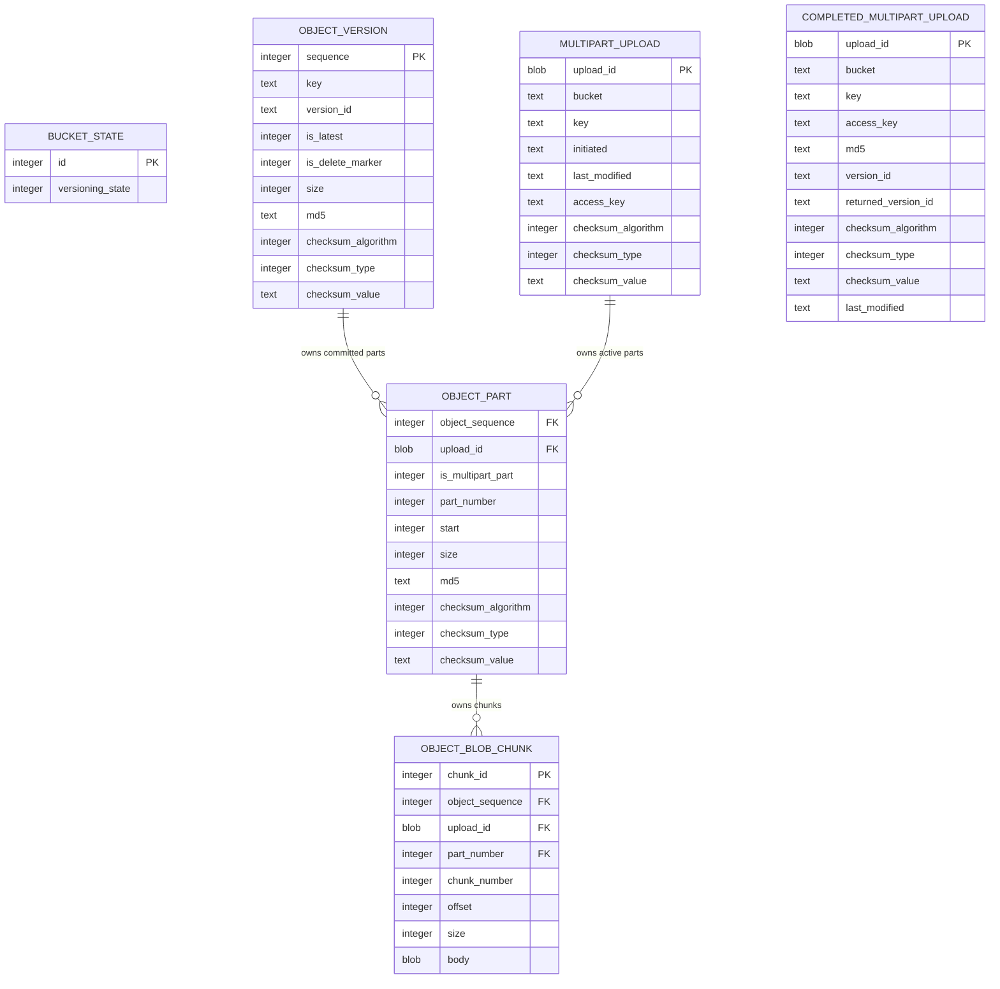

# Unified Chunked SQLite Body Storage

## Summary

- Rework SQLite body storage so committed objects and active multipart parts use one shared chunk table.
- Keep this as a breaking schema change: bump the bucket schema version and reject old databases rather than migrating them.
- Use one shared part-metadata table for active upload parts and completed multipart object parts.
- Use `128 MiB` storage chunks capped by SQLite runtime safety: `min(128 MiB, SQLITE_LIMIT_LENGTH / 2)`.
- Replace the interrupted runtime-limit-only patch with this chunked design.

## Key Changes

- Update the bucket schema:
  - Remove `object_body`.
  - Remove `multipart_upload_part`.
  - Remove `completed_object_part`.
  - Keep `object_version`, `multipart_upload`, and `completed_multipart_upload`.
  - Add `object_part` for storage part metadata owned by exactly one of `object_sequence` or `upload_id`.
  - Add `object_blob_chunk` for bytes owned by exactly one declared `object_part`.
  - Bump the bucket schema version to reject any previous incompatible chunk-storage layout.

- `object_part` stores:
  - `object_sequence`, `upload_id`, `is_multipart_part`, `part_number`, `start`, `size`, `last_modified`, `md5`, checksum fields.
  - Single-request object rows use `object_sequence`, `is_multipart_part = 0`, `part_number = 1`, and `start = 0`.
  - Active multipart rows use `upload_id` and `start IS NULL`.
  - Completed multipart rows use `object_sequence`, `is_multipart_part = 1`, and `start IS NOT NULL`.
  - Add unique indexes for `(upload_id, part_number)` and `(object_sequence, part_number)` so chunks can reference their owning part.

- `object_blob_chunk` stores:
  - `object_sequence`, `upload_id`, `part_number`, `chunk_number`, `offset`, `size`, `body`.
  - Upload-owned chunk `offset` is part-local.
  - Object-owned chunk `offset` is object-global.
  - Add indexes for upload part replacement/completion and object range reads, especially `(object_sequence, offset)`.
  - Add deferred composite foreign keys from `(object_sequence, part_number)` and `(upload_id, part_number)` to `object_part`.

## ER Diagram

`object_part` has exactly one owner: either `object_sequence` for committed object storage or `upload_id` for active multipart upload storage. `object_blob_chunk` repeats that owner and `part_number` so SQLite can enforce a composite foreign key to the exact owning part row. Those chunk-to-part foreign keys are deferred because multipart completion re-owns active part rows and chunk rows inside the same writer transaction. Single PUT/COPY objects still are not S3 multipart objects; they have one storage part with `is_multipart_part = 0`, which S3 multipart metadata queries ignore.

- Write flow:
  - `PutObject` and `CopyObject` create `object_version`, then insert one or more object-owned chunks with `part_number = 1`.
  - `UploadPart` replaces the active `object_part` row and its upload-owned chunks for that part.
  - `UploadPartCopy` stores the selected range as upload-owned chunks.
  - `CompleteMultipartUpload` validates active `object_part` rows, computes completed starts/checksums without concatenating the full object, creates `object_version`, re-owns part rows and chunk rows from `upload_id` to `object_sequence`, deletes the active upload, and records the retry ledger.

- Read flow:
  - Replace single-rowid BLOB streaming with a chunk-span read plan.
  - `GetObject` maps requested ranges or `partNumber` to ordered chunk spans and streams them sequentially.
  - `HeadObject`, `GetObjectAttributes`, `ListParts`, and completed-part metadata read from `object_part`.
  - Zero-length objects should return an empty body without relying on a large/special BLOB.

## Test Plan

- Add schema tests proving all new tables are `STRICT`, have foreign keys, cascade cleanup, owner exclusivity checks, and expected indexes.
- Add SQLite unit tests with a small injected chunk size to prove splitting, ordering, range reads across chunk boundaries, zero-length bodies, part replacement, abort cleanup, and delete/version cascade behavior.
- Add multipart storage tests proving completion re-owns chunks instead of concatenating bytes, sets completed part starts, deletes active upload rows, preserves completed retry behavior, and serves `partNumber`.
- Add conformance/storage transaction readback tests for `PutObject`, `UploadPart`, `UploadPartCopy`, `CompleteMultipartUpload`, `AbortMultipartUpload`, object delete, and version replacement.
- Run:
  - `cargo fmt --all --check`
  - `cargo clippy --all-targets --workspace -- -D warnings`
  - `cargo test`
  - targeted `storage_transactions`, object, multipart, copy, get/range, and SQLite module tests.

## Assumptions

- Old bucket databases must be exported and reimported; no migration path is implemented.
- Single PUT and UploadPart still buffer request bodies because of the current `s3s` body flow; this change fixes SQLite BLOB limits and multipart completion concatenation, not streaming upload ingestion.
- S3 protocol limits remain: single PUT/copy/upload-part max is `5 GiB`; multipart completion can store larger final objects through chunks.
- New schema tables are `STRICT` and not `WITHOUT ROWID`.
- Referential integrity is enforced by foreign keys wherever SQLite can express it; aggregate shape invariants such as contiguous chunk offsets and total part size matching object size remain validated by storage readback code and transaction tests.
- New local/storage tests do not receive Ceph `s3-tests` mirror comments.
